# Arsitektur Teknis & Skema Data Model (ERD)
## Odoo Service Supply Chain Management (SSCM)

Dokumen ini mendefinisikan arsitektur data model teknis, Entity-Relationship Diagram (ERD), relasi antar model Odoo (Many2one, One2many, Many2many), dan logika constraints untuk sistem Service Supply Chain Management.

---

## 1. Entity-Relationship Diagram (ERD)

```mermaid
erDiagram
    RES_PARTNER ||--o{ FLEET_VEHICLE : owns
    RES_PARTNER ||--o{ SALON_TREATMENT_HISTORY : has_records
    RES_PARTNER ||--o{ WORKSHOP_SERVICE_ORDER : requests
    RES_PARTNER ||--o{ SALON_APPOINTMENT : books

    HR_EMPLOYEE ||--o{ WORKSHOP_SERVICE_ORDER : works_as_mechanic
    HR_EMPLOYEE ||--o{ SALON_APPOINTMENT : works_as_therapist
    HR_EMPLOYEE ||--o{ SERVICE_COMMISSION_LINE : earns

    WORKSHOP_BAY ||--o{ WORKSHOP_SERVICE_ORDER : allocated_to
    SALON_CHAIR ||--o{ SALON_APPOINTMENT : allocated_to

    PRODUCT_PRODUCT ||--o{ WORKSHOP_SERVICE_LINE : service_definition
    PRODUCT_PRODUCT ||--o{ WORKSHOP_PARTS_LINE : consumed_parts
    PRODUCT_PRODUCT ||--o{ SALON_APPOINTMENT : booked_service

    WORKSHOP_SERVICE_ORDER ||--o{ WORKSHOP_SERVICE_LINE : contains_services
    WORKSHOP_SERVICE_ORDER ||--o{ WORKSHOP_PARTS_LINE : consumes_parts
    WORKSHOP_SERVICE_ORDER ||--o{ WORKSHOP_WARRANTY_CLAIM : originates_claims
    WORKSHOP_SERVICE_ORDER ||--o{ SERVICE_COMMISSION_LINE : generates_commissions
    WORKSHOP_SERVICE_ORDER ||--|| ACCOUNT_MOVE : billed_to_invoice

    SALON_APPOINTMENT ||--o{ SALON_TREATMENT_HISTORY : creates_history
    SALON_APPOINTMENT ||--o{ SALON_WARRANTY_CLAIM : originates_claims
    SALON_APPOINTMENT ||--o{ SERVICE_COMMISSION_LINE : generates_commissions
    SALON_APPOINTMENT ||--|| POS_ORDER : billed_to_pos
```



---

## 2. Struktur Modul & Konvensi Inheritance Odoo

Arsitektur aplikasi dibagi menjadi struktur modular sesuai best practices Odoo:

```
odoo-SSCM/
├── README.md
├── PRD.md
├── ARCHITECTURE.md
└── addons/
    ├── sscm_core/                     # Modul fondasi (komisi karyawan, payment webhook helper)
    ├── sscm_workshop/                 # Modul bengkel, carwash, bay antrean, vehicle & warranty
    └── sscm_salon/                    # Modul salon, chair/bed, treatment card, dual-scheduling
```

---

## 3. Spesifikasi Data Model Teknis

### A. Modul Inherit (Perluasan Model Bawaan Odoo)

#### 1. `res.partner` (Profil Pelanggan)
```python
class ResPartner(models.Model):
    _inherit = 'res.partner'

    vehicle_ids = fields.One2many(
        'fleet.vehicle', 'owner_id', string='Daftar Kendaraan'
    )
    treatment_history_ids = fields.One2many(
        'salon.treatment.history', 'partner_id', string='Riwayat Perawatan Salon/Klinik'
    )
    workshop_order_count = fields.Integer(
        string='Total Servis Bengkel', compute='_compute_service_counts'
    )
    salon_visit_count = fields.Integer(
        string='Total Kunjungan Salon', compute='_compute_service_counts'
    )
```

#### 2. `fleet.vehicle` (Aset Kendaraan Pelanggan)
```python
class FleetVehicle(models.Model):
    _inherit = 'fleet.vehicle'

    owner_id = fields.Many2one(
        'res.partner', string='Pemilik Kendaraan', required=True, tracking=True
    )
    odometer_last = fields.Float(
        string='KM Terakhir', tracking=True, help="Odometer tercatat saat servis terakhir"
    )
    service_order_ids = fields.One2many(
        'workshop.service.order', 'vehicle_id', string='Histori SPK Bengkel'
    )
    warranty_active = fields.Boolean(
        string='Garansi Aktif', compute='_compute_warranty_status'
    )
```

#### 3. `hr.employee` (Tenaga Kerja & Konfigurasi Komisi)
```python
class HrEmployee(models.Model):
    _inherit = 'hr.employee'

    service_role = fields.Selection([
        ('mechanic', 'Mekanik'),
        ('washer', 'Petugas Cuci / Detailing'),
        ('therapist', 'Terapis'),
        ('doctor', 'Dokter Estetika'),
        ('stylist', 'Hairstylist / Barber'),
    ], string='Peran Layanan')

    commission_rate_service = fields.Float(
        string='Komisi Jasa (%)', default=15.0, help="Persentase komisi dari pengerjaan jasa"
    )
    commission_rate_product = fields.Float(
        string='Komisi Produk Ritel (%)', default=5.0, help="Persentase komisi upselling produk"
    )
    commission_line_ids = fields.One2many(
        'service.commission.line', 'employee_id', string='Buku Komisi'
    )
```

---

### B. Data Model Kasus Bengkel & Carwash (`sscm_workshop`)

#### 1. `workshop.bay` (Pit / Lift / Bay Kerja)
```python
class WorkshopBay(models.Model):
    _name = 'workshop.bay'
    _description = 'Workcenter Bay / Pit Bengkel & Carwash'

    name = fields.Char(string='Nama Bay / Pit', required=True)
    bay_type = fields.Selection([
        ('general_repair', 'Pit Servis Umum'),
        ('heavy_repair', 'Pit Servis Berat / Turun Mesin'),
        ('spooring', 'Pit Spooring & Balancing'),
        ('carwash', 'Bay Cuci & Detailing'),
    ], string='Tipe Bay', required=True, default='general_repair')
    
    state = fields.Selection([
        ('available', 'Tersedia'),
        ('occupied', 'Sedang Digunakan'),
        ('maintenance', 'Perawatan / Rusak'),
    ], default='available', tracking=True)
    
    current_order_id = fields.Many2one(
        'workshop.service.order', string='Order yang Sedang Berjalan'
    )
```

#### 2. `workshop.service.order` (Perintah Kerja Bengkel / SPK)
```python
class WorkshopServiceOrder(models.Model):
    _name = 'workshop.service.order'
    _description = 'Surat Perintah Kerja (SPK) Bengkel'
    _inherit = ['mail.thread', 'mail.activity.mixin']

    name = fields.Char(string='No. SPK', required=True, copy=False, readonly=True, default='New')
    partner_id = fields.Many2one('res.partner', string='Pelanggan', required=True, tracking=True)
    vehicle_id = fields.Many2one('fleet.vehicle', string='Kendaraan', required=True, tracking=True)
    odometer_in = fields.Float(string='Odometer Masuk (KM)', required=True)
    
    bay_id = fields.Many2one('workshop.bay', string='Alokasi Pit/Bay', tracking=True)
    mechanic_id = fields.Many2one('hr.employee', string='Mekanik Utama', tracking=True)
    washer_id = fields.Many2one('hr.employee', string='Petugas Cuci (Carwash)')

    state = fields.Selection([
        ('draft', 'Draft / Booking'),
        ('queue', 'Antrean Masuk'),
        ('in_progress', 'Sedang Dikerjakan'),
        ('qc', 'Quality Control'),
        ('carwash', 'Cuci & Detailing'),
        ('done', 'Selesai & Siap Bayar'),
        ('invoiced', 'Selesai & Lunas'),
        ('cancel', 'Dibatalkan'),
    ], default='draft', tracking=True)

    complaint = fields.Text(string='Keluhan Pelanggan')
    diagnosis = fields.Text(string='Hasil Diagnosa Mekanik')

    service_line_ids = fields.One2many('workshop.service.line', 'order_id', string='Rincian Jasa')
    parts_line_ids = fields.One2many('workshop.parts.line', 'order_id', string='Suku Cadang & Oli')
    
    warranty_expiration_date = fields.Date(string='Garansi Berlaku Hingga (Tanggal)', compute='_compute_warranty_period')
    warranty_expiration_km = fields.Float(string='Garansi Berlaku Hingga (KM)', compute='_compute_warranty_period')

    invoice_id = fields.Many2one('account.move', string='Faktur Penjualan', readonly=True)
```

#### 3. `workshop.warranty.claim` (Klaim Garansi Servis)
```python
class WorkshopWarrantyClaim(models.Model):
    _name = 'workshop.warranty.claim'
    _description = 'Klaim Garansi Servis Bengkel'
    _inherit = ['mail.thread']

    name = fields.Char(string='Nomor Klaim', required=True, default='New')
    original_order_id = fields.Many2one('workshop.service.order', string='SPK Sumber', required=True)
    vehicle_id = fields.Many2one(related='original_order_id.vehicle_id', string='Kendaraan', readonly=True)
    partner_id = fields.Many2one(related='original_order_id.partner_id', string='Pelanggan', readonly=True)
    
    claim_date = fields.Date(string='Tanggal Klaim', default=fields.Date.context_today)
    odometer_claim = fields.Float(string='Odometer Saat Klaim (KM)', required=True)
    claim_reason = fields.Text(string='Keluhan Tambahan / Cacat Pengerjaan', required=True)
    
    is_valid_warranty = fields.Boolean(string='Status Garansi Valid', compute='_compute_warranty_validity')
    action_taken = fields.Selection([
        ('free_repair', 'Servis Ulang Gratis (Rp 0)'),
        ('supplier_claim', 'Retur Suku Cadang ke Supplier'),
        ('rejected', 'Klaim Ditolak (Di luar masa/syarat garansi)'),
    ], string='Tindakan')
    
    state = fields.Selection([
        ('draft', 'Pengajuan'),
        ('investigation', 'Pemeriksaan Teknisi'),
        ('approved', 'Disetujui'),
        ('done', 'Selesai'),
        ('rejected', 'Ditolak'),
    ], default='draft')
```

---

### C. Data Model Kasus Salon & Klinik Kecantikan (`sscm_salon`)

#### 1. `salon.chair` (Kursi / Bed Fasilitas)
```python
class SalonChair(models.Model):
    _name = 'salon.chair'
    _description = 'Kursi / Bed Fasilitas Salon'

    name = fields.Char(string='Nama Fasilitas', required=True)
    resource_type = fields.Selection([
        ('hair_chair', 'Kursi Potong / Styling'),
        ('facial_bed', 'Bed Facial / Estetika'),
        ('nail_station', 'Meja Nail Art & Manicure'),
        ('laser_room', 'Ruang Tindakan Dokter / Laser'),
    ], string='Tipe Fasilitas', required=True)
    active = fields.Boolean(default=True)
```

#### 2. `salon.appointment` (Booking & Alokasi Dual-Resource)
```python
class SalonAppointment(models.Model):
    _name = 'salon.appointment'
    _description = 'Booking & Sesi Treatment Salon'
    _inherit = ['mail.thread']

    name = fields.Char(string='Nomor Booking', required=True, default='New')
    partner_id = fields.Many2one('res.partner', string='Pelanggan', required=True)
    therapist_id = fields.Many2one('hr.employee', string='Terapis / Stylist', required=True)
    chair_id = fields.Many2one('salon.chair', string='Kursi / Bed', required=True)
    service_id = fields.Many2one('product.product', string='Paket Treatment', domain=[('type', '=', 'service')], required=True)

    start_time = fields.Datetime(string='Waktu Mulai', required=True)
    end_time = fields.Datetime(string='Waktu Selesai', required=True)

    state = fields.Selection([
        ('draft', 'Draft Reservasi'),
        ('confirmed', 'Terkonfirmasi'),
        ('in_service', 'Sedang Berjalan'),
        ('done', 'Selesai'),
        ('cancel', 'Dibatalkan'),
    ], default='draft', tracking=True)

    pos_order_id = fields.Many2one('pos.order', string='Order Kasir POS')

    @api.constrains('therapist_id', 'chair_id', 'start_time', 'end_time')
    def _check_conflicts(self):
        for record in self:
            domain = [
                ('id', '!=', record.id),
                ('state', 'in', ['confirmed', 'in_service']),
                ('start_time', '<', record.end_time),
                ('end_time', '>', record.start_time),
            ]
            if self.search(domain + [('therapist_id', '=', record.therapist_id.id)]):
                raise ValidationError(f"Terapis {record.therapist_id.name} telah memiliki jadwal di jam tersebut!")
            if self.search(domain + [('chair_id', '=', record.chair_id.id)]):
                raise ValidationError(f"Kursi/Bed {record.chair_id.name} sedang terpakai pada jam tersebut!")
```

#### 3. `salon.treatment.history` (Kartu Rekam Perawatan / Formula)
```python
class SalonTreatmentHistory(models.Model):
    _name = 'salon.treatment.history'
    _description = 'Kartu Rekam Perawatan Pelanggan'
    _order = 'treatment_date desc'

    partner_id = fields.Many2one('res.partner', string='Pelanggan', required=True, ondelete='cascade')
    appointment_id = fields.Many2one('salon.appointment', string='Sesi Booking')
    treatment_date = fields.Date(string='Tanggal', default=fields.Date.context_today)
    therapist_id = fields.Many2one('hr.employee', string='Terapis')
    service_id = fields.Many2one('product.product', string='Layanan')
    
    formula_notes = fields.Text(string='Formula / Racikan Obat (Warna/Peeling/Serum)')
    skin_hair_condition = fields.Text(string='Kondisi Fisik Kulit/Rambut')
    photo_before = fields.Binary(string='Foto Sebelum')
    photo_after = fields.Binary(string='Foto Sesudah')
```

---

### D. Data Model Mesin Komisi Karyawan (`sscm_core`)

#### 1. `service.commission.line` (Buku Besar Komisi Staf)
```python
class ServiceCommissionLine(models.Model):
    _name = 'service.commission.line'
    _description = 'Buku Besar Komisi & Insentif Karyawan'
    _order = 'date desc'

    name = fields.Char(string='Referensi Transaksi', required=True)
    employee_id = fields.Many2one('hr.employee', string='Karyawan Penerima', required=True)
    date = fields.Date(string='Tanggal Transaksi', default=fields.Date.context_today)
    
    commission_type = fields.Selection([
        ('service', 'Komisi Pengerjaan Jasa'),
        ('product_upsell', 'Insentif Penjualan Produk'),
        ('team_pool', 'Bagi Hasil Tim (Carwash Pool)'),
    ], string='Tipe Komisi', required=True)
    
    base_amount = fields.Monetary(string='Dasar Pengenaan Komisi (DPP)')
    percentage = fields.Float(string='Persentase Komisi (%)')
    amount = fields.Monetary(string='Total Komisi Diterima', compute='_compute_commission_amount', store=True)
    currency_id = fields.Many2one('res.currency', default=lambda self: self.env.company.currency_id)
    
    state = fields.Selection([
        ('accrued', 'Tercatat (Accrued)'),
        ('paid_in_payroll', 'Sudah Dicairkan di Gaji'),
        ('cancelled', 'Dibatalkan'),
    ], default='accrued')

    @api.depends('base_amount', 'percentage')
    def _compute_commission_amount(self):
        for rec in self:
            rec.amount = rec.base_amount * (rec.percentage / 100.0)
```

---

## 4. Mekanisme Otomatisasi Antar-Modul (Workflow Triggers)

1. **Trigger Penyelesaian Servis Bengkel (`workshop.service.order` action_done):**
   * Status bay otomatis kembali menjadi `available`.
   * Validasi mutasi pengeluaran suku cadang di gudang (`stock.picking`).
   * Perhitungan batas garansi: Tanggal hari ini + 14 hari, KM sekarang + 1.000 KM.
2. **Trigger Pembayaran Tagihan (Invoice / POS Order Paid):**
   * Pemotongan bahan habis pakai berbasis BOM Kit (untuk salon).
   * Pembuatan record komisi di `service.commission.line` untuk teknisi/terapis terkait.
   * Notifikasi status selesai dikirimkan ke pelanggan via template WhatsApp/Email.

---

## 5. Implementasi Teknis pada Odoo SaaS / Studio (`bengkelhanin1.odoo.com`)

Pada lingkungan SaaS, arsitektur di atas diimplementasikan melalui Studio Metadata API:

### A. Daftar 17 Custom Fields (Tersimpan di `ir.model.fields`)
1. **Model `fleet.vehicle` (ID: 3524):**
   * `x_owner_id` (Many2one $\rightarrow$ `res.partner`, Field ID: 17822)
   * `x_odometer_last` (Float, Field ID: 17824)
2. **Model `repair.order` (ID: 4110):**
   * `x_vehicle_id` (Many2one $\rightarrow$ `fleet.vehicle`, Field ID: 17826)
   * `x_odometer_in` (Float, Field ID: 17828)
   * `x_bay_allocation` (Selection, Field ID: 17830)
   * `x_mechanic_id` (Many2one $\rightarrow$ `hr.employee`, Field ID: 17832)
   * `x_washer_id` (Many2one $\rightarrow$ `hr.employee`, Field ID: 17834)
   * `x_complaint` (Text, Field ID: 17836)
   * `x_diagnosis` (Text, Field ID: 17838)
   * `x_warranty_exp_date` (Date, Field ID: 17840)
   * `x_warranty_exp_km` (Float, Field ID: 17842)
3. **Model `res.partner` (ID: 91):**
   * `x_skin_hair_type` (Char, Field ID: 17844)
   * `x_known_allergies` (Text, Field ID: 17847)
   * `x_formula_notes` (Text, Field ID: 17850)
4. **Model `hr.employee` (ID: 2949):**
   * `x_service_role` (Selection, Field ID: 17853)
   * `x_commission_service_rate` (Float, Field ID: 17855)
   * `x_commission_product_rate` (Float, Field ID: 17857)

### B. Daftar Inherited Views (Tersimpan di `ir.ui.view`)
* `repair.order.form.inherit.sscm` (View ID: 2124, Inherit ID: 1803)
* `fleet.vehicle.form.inherit.sscm` (View ID: 2125, Inherit ID: 758)
* `res.partner.form.inherit.salon` (View ID: 2126, Inherit ID: 127)
* `hr.employee.form.inherit.sscm` (View ID: 2127, Inherit ID: 674)
* `repair.order.kanban.inherit.sscm` (View ID: 2128, Inherit ID: 1804)

